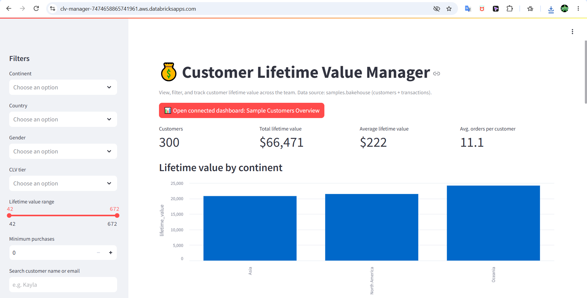
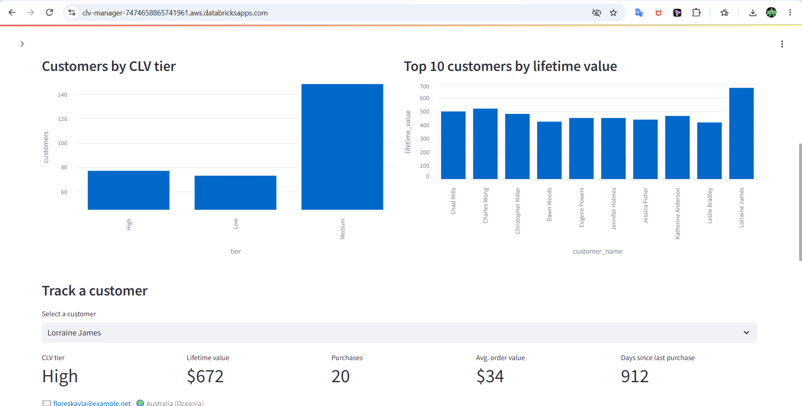
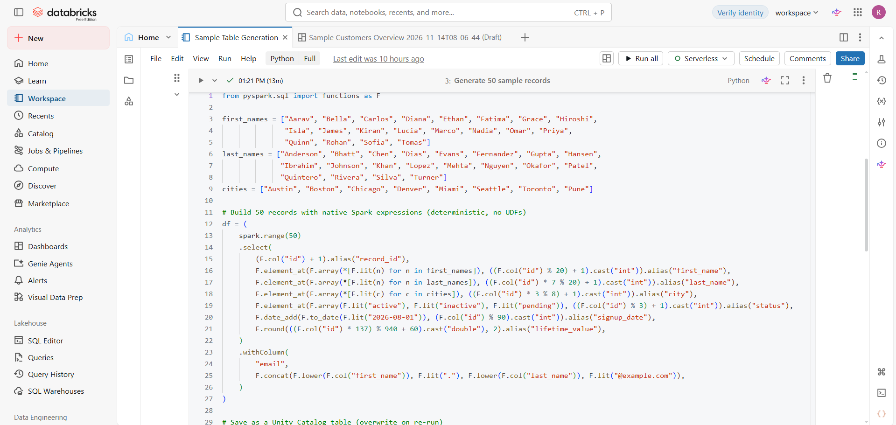
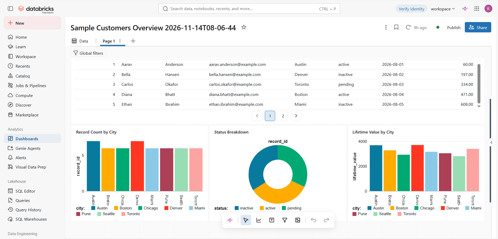

# 💰 CLV Manager — Customer Lifetime Value Manager on Databricks

**clv-manager** is a [Databricks App](https://docs.databricks.com/aws/en/dev-tools/databricks-apps/) (Streamlit) for viewing, filtering, searching, and tracking **customer lifetime value (CLV)**. It computes per-customer CLV metrics from Databricks sample data, mirrors them into a **Lakebase Postgres** (OLTP) database, and deep-links into a connected **AI/BI dashboard** — a compact end-to-end demo of the modern Databricks lakehouse + apps stack.

---

## 🖼️ Views

All the views below are captured in [`screenshots/`](screenshots).

### 1. App overview — KPIs, filters, and lifetime value by continent



What you're seeing:

* **Header** — the app title *Customer Lifetime Value Manager* with a short tagline naming the data source: `samples.bakehouse` (customers + transactions).
* **Red banner button** — *Open connected dashboard: Sample Customers Overview*. One click opens the linked AI/BI dashboard (see view 4) in a new tab.
* **KPI cards** across the top of the page:
  * **Customers** — `300` customers in the current (unfiltered) view.
  * **Total lifetime value** — `$66,471` summed across all customers.
  * **Average lifetime value** — `$222` per customer.
  * **Avg. orders per customer** — `11.1` transactions each.
* **"Lifetime value by continent" bar chart** — total LTV for Asia (~$21K), North America (~$21.5K), and Oceania (~$24K), showing Oceania as the top-contributing continent in the sample data.
* **Filters sidebar (left)** — every widget drives the whole page reactively:
  * **Continent**, **Country**, **Gender**, **CLV tier** dropdowns.
  * **Lifetime value range** dual slider (here `42`–`672`, the observed min/max).
  * **Minimum purchases** number stepper (default `0`).
  * **Search customer name or email** free-text box (e.g. type "Kayla").

### 2. App detail charts — CLV tiers, top customers, and per-customer tracking



What you're seeing (same page, scrolled down):

* **"Customers by CLV tier" bar chart** — how the 300 customers split across the quartile-based segments: **Medium ~150**, **High ~77**, **Low ~73**.
* **"Top 10 customers by lifetime value" bar chart** — the highest-LTV customers, led by **Lorraine James (~$672)**, followed by Charles Wong, Christopher Miller, Chad Mills, Katherine Anderson, Eugene Powers, Jennifer Holmes, Jessica Fisher, Dawn Woods, and Leslie Bradley.
* **"Track a customer" section** — a customer picker (here **Lorraine James**) with that customer's full profile rendered as KPIs:
  * **CLV tier**: `High`
  * **Lifetime value**: `$672`
  * **Purchases**: `20`
  * **Avg. order value**: `$34`
  * **Days since last purchase**: `912`
  * Contact line with email and a country/continent badge (Australia, Oceania).

### 3. Sample Table Generation notebook — creating the demo dataset



What you're seeing:

* The **Sample Table Generation** notebook open in the Databricks workspace (serverless compute), cell *"3: Generate 50 sample records"*.
* **PySpark code that deterministically fabricates 50 demo customer records** with native Spark expressions — no UDFs, so it runs fast and reproduces identical data on every run:
  * Hard-coded pools of `first_names`, `last_names`, and `cities` (Austin, Boston, Chicago, Denver, Miami, Seattle, Toronto, Pune).
  * `spark.range(50)` drives row generation; `F.element_at` + modulo arithmetic (`id % 20`, `id * 7 % 20`, `id * 3 % 8`, `id % 3`) deterministically assign names, cities, and an `active`/`inactive`/`pending` status.
  * `signup_date` offsets 0–90 days from `2026-08-01`; `lifetime_value = ((id * 137) % 940) + 60`.
  * Emails are composed as `first.last@example.com`.
* The final comment shows the next step: **save as a Unity Catalog table (overwrite on re-run)** → `workspace.default.sample_customers`.
* The workspace tab bar also shows the *Sample Customers Overview* dashboard draft open alongside the notebook.

### 4. Sample Customers Overview AI/BI dashboard



What you're seeing:

* The **"Sample Customers Overview 2026-11-14T08-06-44"** AI/BI dashboard (draft view) — the dashboard the app deep-links to; the app's URL is embedded back into the dashboard so you can jump in both directions.
* **Paginated data table** (5 rows per page, 2 pages) of the 50 records from `workspace.default.sample_customers`: record id, first/last name, email, city, status, signup date, and lifetime value — e.g. *Aarav Anderson, aarav.anderson@example.com, Austin, active, 2026-08-01, 60.00*.
* **"Global filters"** button for cross-widget filtering.
* Three charts built on the sample table:
  * **Record Count by City** — bar chart with a similar number of records (6–7) per city.
  * **Status Breakdown** — donut chart of the `active` / `inactive` / `pending` split.
  * **Lifetime Value by City** — bar chart of total LTV per city (~$2,900–$3,900 each).

---

## What the app does

* Runs a **CLV aggregation** over `samples.bakehouse.sales_customers` ⋈ `sales_transactions`: purchase count, lifetime value, average order value, and days since last purchase per customer.
* Segments customers into **High / Medium / Low** CLV tiers by lifetime-value quartiles (≥75th percentile → High, ≥25th → Medium, else Low).
* Renders a filterable Streamlit UI (continent, country, gender, tier, LTV range, minimum purchases, name/email search) with KPI cards, three charts, and a per-customer tracker.
* **Mirrors** the aggregated metrics into Lakebase Postgres (`clv.customer_clv`) on page load, using OAuth-generated database credentials — demonstrating an OLTP write path from a Databricks App.
* Deep-links to the connected **AI/BI dashboard**.

## Architecture / data flow

```text
samples.bakehouse (sales_customers ⋈ sales_transactions)
        │  SQL aggregation via the app's SQL warehouse (serverless)
        ▼
   clv-manager (Streamlit on Databricks Apps)
        │                        │
        │ OAuth-generated creds  │ deep link
        ▼                        ▼
Lakebase Postgres            AI/BI dashboard
clv.customer_clv             "Sample Customers Overview"
(OLTP mirror, 300 rows)      (built on workspace.default.sample_customers)
```

## App details

| Field | Value |
| --- | --- |
| App name | clv-manager |
| App ID | 968d3779-6161-405e-b5d0-46ddebf185a9 |
| Compute size | MEDIUM |
| Command | streamlit run app.py |
| API scopes | sql |
| Git repository | https://github.com/ramrounakmukherjee-blip/clv-manager-databricks- |

## Connected resources

* **SQL warehouse**: `/sql/1.0/warehouses/dcc76b7ee7627b72` (injected as `SQL_WAREHOUSE_HTTP_PATH`) for the CLV aggregation query.
* **Lakebase Postgres database**: `projects/clv-app-db/branches/production/databases/databricks-postgres` (resource name `postgres`, permission `CAN_CONNECT_AND_CREATE`). The app mirrors per-customer CLV metrics into the `clv.customer_clv` table using OAuth-generated database credentials.
* **AI/BI dashboard**: Sample Customers Overview (UUID `01f1e00255a51ab68b084f6c014c9a40`) — the app deep-links to it and the app URL is embedded back into the dashboard.

## Data source & CLV tier logic

Per-customer CLV aggregation from the shared Databricks sample data in `samples.bakehouse` (`sales_customers` joined with `sales_transactions`), computing purchase count, lifetime value, average order value, and days since last purchase. Customers are segmented into High / Medium / Low CLV tiers by quartile of lifetime value.

## The sample-data project

* **`notebooks/Sample Table Generation`** — creates the `workspace.default.sample_customers` Unity Catalog table and generates the 50 deterministic sample customer records (SQL DDL + PySpark, native expressions, no UDFs). Re-running overwrites the table.
* **`dashboards/sample_customers_overview.json`** — serialized config of the "Sample Customers Overview" AI/BI dashboard. To restore it in a Databricks workspace, rename to `.lvdash.json` and import.
* **`data/sample_customers.csv`** — export of all 50 generated records (snapshot taken 2026-11-14).
* **`data/lakebase_customer_clv.csv`** — export of the 300 customer CLV records mirrored into the Lakebase `clv.customer_clv` table (snapshot taken 2026-11-14).

## Environment variables

* `SQL_WAREHOUSE_HTTP_PATH` — set in `app.yaml` (the app's SQL warehouse).
* `LAKEBASE_ENDPOINT` — Lakebase Postgres endpoint, declared in `app.yaml` via `valueFrom: postgres`; `app.py` also honors `ENDPOINT_NAME` and falls back to `projects/clv-app-db/branches/production/endpoints/primary`.
* `PGDATABASE`, `PGUSER`, `PGHOST`, `PGPORT`, `PGSSLMODE` — injected Lakebase Postgres connection settings (with sensible fallbacks in `app.py` for local runs).

## Repository contents

```text
.
├── app.py                                    # Streamlit app: query, filters, charts, Lakebase sync
├── app.yaml                                  # App command + env (incl. LAKEBASE_ENDPOINT from postgres resource)
├── requirements.txt                          # streamlit, pandas, databricks-sdk, databricks-sql-connector, psycopg
├── notebooks/Sample Table Generation         # Creates workspace.default.sample_customers (50 records)
├── dashboards/sample_customers_overview.json # AI/BI dashboard config (rename to .lvdash.json to import)
├── data/sample_customers.csv                 # Export of the 50 sample records
├── data/lakebase_customer_clv.csv            # Export of the 300 mirrored CLV records
├── learnings/                                 # Databricks learning notes (intro to the platform)
└── screenshots/                              # App & workspace views used in this README
```

## Running locally

Install dependencies and run the Streamlit server (requires Databricks workspace authentication):

```sh
pip install -r requirements.txt
streamlit run app.py
```

## Lakebase sync (troubleshooting)

On page load the app upserts all CLV rows into `clv.customer_clv` (keyed by `customer_id`, with a `synced_at` timestamp). If the banner shows *"Lakebase sync skipped: ..."*:

1. **Permission denied** — the connecting role needs `USAGE` on schema `clv` and `SELECT, INSERT, UPDATE` on `clv.customer_clv`:

   ```sql
   GRANT USAGE ON SCHEMA clv TO "<app-service-principal-client-id>";
   GRANT SELECT, INSERT, UPDATE ON clv.customer_clv TO "<app-service-principal-client-id>";
   ```

2. **Missing endpoint** — confirm the app's `postgres` resource points at `projects/clv-app-db/branches/production/endpoints/primary` and that `LAKEBASE_ENDPOINT` is declared in `app.yaml`.
